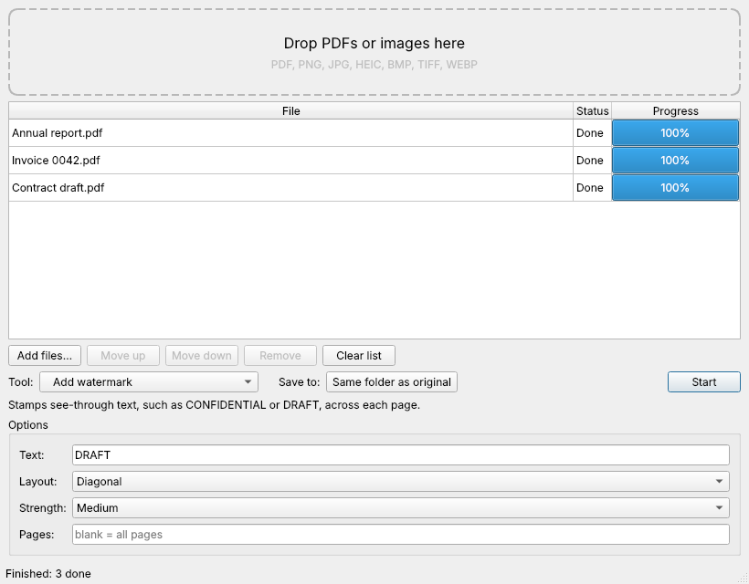

# File Converter

An offline desktop app for Windows, macOS and Linux that converts PDFs and images into Word, Excel, PDF and image files, and has everyday PDF tools (merge, split, compress, watermark, passwords and more). Nothing is uploaded anywhere: everything runs on your own computer.



## Status

| Conversion | Status |
| --- | --- |
| PDF → Word (.docx) | ✅ Text PDFs (layout, images and tables kept) |
| PDF → Excel (.xlsx) | ✅ Text PDFs (each page with tables becomes a sheet; numbers stay numbers) |
| Images (JPG, PNG, HEIC, TIFF, …) → PDF | ✅ One PDF per image, or all combined; A4, Letter or image size; phone photos stay upright |
| PDF → JPG / PNG | ✅ One image per page, 72, 150 or 300 dpi |
| Extract images from PDF | ✅ Original quality |
| Image / scanned PDF → Word or Excel (OCR) | Planned (step 3) |
| Installers for Windows, macOS, Linux | ✅ Built automatically, see below |

### PDF tools

| Group | Tools |
| --- | --- |
| Organize pages | Merge PDFs (in list order, use Move up / Move down), Split (every page or ranges like `1-3, 4-`), Extract pages, Remove pages, Rotate pages |
| Optimize | Compress (three strengths, shows how much smaller), Flatten forms and comments |
| Edit | Add page numbers (position, style such as "Page 1 of 9", first number), Add watermark (diagonal or straight, three strengths) |
| Security | Protect with password (AES-256), Remove password (you need the current one) |

Pick a tool, fill in its options, and press **Start**. Every tool saves a new file (or folder) next to the original, such as `report (rotated).pdf`; originals are never changed. Tools that take page numbers accept ranges like `1-3, 5, 8-`, and blank means every page.

Scanned PDFs, password-protected PDFs and PDFs without tables (for Excel) are rejected with a clear message. Click a failed file to see why.

## Install

Download the latest installer from the [Releases page](https://github.com/SpOok548/file-converter/releases/latest):

- **Windows:** `FileConverter-Setup-<version>.exe`. Run it and follow the steps. Windows may show "Windows protected your PC" because the installer isn't code-signed yet; click **More info → Run anyway**.
- **macOS (Apple Silicon):** `FileConverter-<version>-macOS.dmg`. Open it and drag File Converter into Applications. The first time, right-click the app and choose **Open**, because it isn't notarized by Apple yet.
- **Linux:** `FileConverter-<version>-x86_64.AppImage`. Make it executable (`chmod +x`) and double-click it.

## Make a new release

1. Bump `__version__` in `src/file_converter/__init__.py` and `version` in `pyproject.toml`.
2. Tag and push: `git tag v0.2.0 && git push origin v0.2.0`.
3. GitHub Actions builds all three installers, tests that each one converts a PDF, and publishes them as a release.

To build installers without releasing, open **Actions → Build installers → Run workflow**.

## Command line

```bash
file-converter --convert report.pdf --to xlsx --output report.xlsx
```

## Run from source

Requires Python 3.10 or newer.

```bash
python -m venv .venv
source .venv/bin/activate        # Windows: .venv\Scripts\activate
pip install -e ".[dev]"
python -m file_converter
```

## Run the tests

```bash
pytest
```

## How it's organised

- `src/file_converter/ui/main_window.py`: the window (drag and drop, file list, tool picker, options form, Start button).
- `src/file_converter/worker.py`: runs each conversion in the background so the window never freezes.
- `src/file_converter/converters/`: one class per tool. Each tool declares an `Action` (its name, group, output extension and options); the window builds the options form from it. To add a tool, declare an `Action`, subclass `Converter`, set `input_extensions` and `output_format`, implement `convert()` (or `combine()` for many-files-into-one tools like merge), and register it in `default_registry()`.

## Licensing note

PDF to Word uses [pdf2docx](https://github.com/ArtifexSoftware/pdf2docx), which depends on PyMuPDF, and the PDF tools use [PyMuPDF](https://github.com/pymupdf/PyMuPDF) directly. PyMuPDF is licensed under the GNU AGPL 3.0 (or a paid Artifex commercial licence), so a published build of this app must either be released under the AGPL with its source available, or use a commercial PyMuPDF licence.
