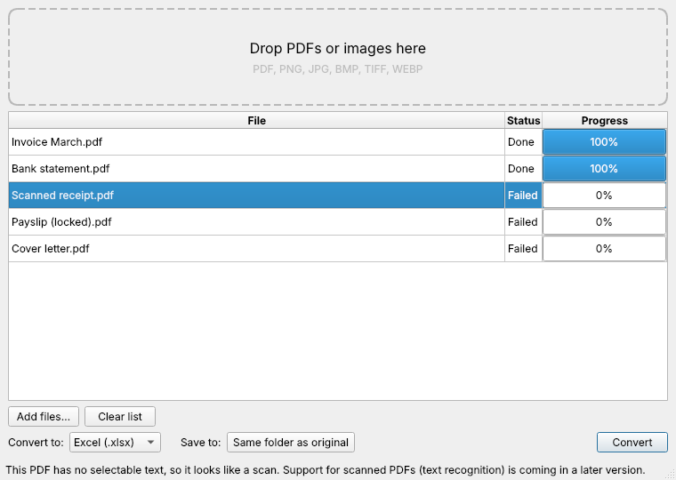

# File Converter

An offline desktop app for Windows, macOS and Linux that converts PDFs and images into Word and Excel files. Nothing is uploaded anywhere: every conversion runs on your own computer.



## Status

| Conversion | Status |
| --- | --- |
| PDF → Word (.docx) | ✅ Text PDFs (layout, images and tables kept) |
| PDF → Excel (.xlsx) | ✅ Text PDFs (each page with tables becomes a sheet; numbers stay numbers) |
| Image / scanned PDF → Word or Excel (OCR) | Planned (step 3) |
| Installers for Windows, macOS, Linux | Planned (step 4) |

Scanned PDFs, password-protected PDFs and PDFs without tables (for Excel) are rejected with a clear message. Click a failed file to see why.

## Run from source

Requires Python 3.10 or newer.

```bash
python -m venv .venv
source .venv/bin/activate        # Windows: .venv\Scripts\activate
pip install -e ".[dev]"
python -m file_converter
```

## Run the tests

```bash
pytest
```

## How it's organised

- `src/file_converter/ui/main_window.py`: the window (drag and drop, file list, format picker, Convert button).
- `src/file_converter/worker.py`: runs each conversion in the background so the window never freezes.
- `src/file_converter/converters/`: one class per conversion. To add a conversion, subclass `Converter`, set `input_extensions` and `output_format`, implement `convert()`, and register it in `default_registry()`.

## Licensing note

PDF to Word uses [pdf2docx](https://github.com/ArtifexSoftware/pdf2docx), which depends on PyMuPDF. PyMuPDF is licensed under the GNU AGPL 3.0 (or a paid Artifex commercial licence), so a published build of this app must either be released under the AGPL with its source available, or use a commercial PyMuPDF licence.
